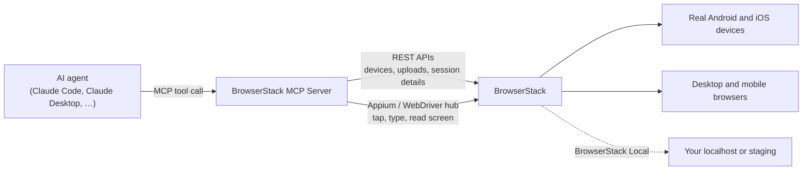

# Agent-driven devices and browsers

The BrowserStack MCP Server can now hand an AI agent a **real iPhone, Android phone or desktop browser** on BrowserStack and let it work step by step. The agent installs your app, looks at the screen, taps, types, swipes and checks the result, the way a person would in a manual test. It works in Claude Code, Claude Desktop, Cursor, VS Code, Codex and any other MCP client.

The server only provides the capabilities. Deciding what to do next stays with the agent and the person using it.

---

## Who it is for

- **Developers** who want their coding agent to check a fix on a real device before they push it.
- **QA engineers** who want an agent to run through a flow ("sign up, add to cart, pay") on several devices and report what it saw.
- **Teams testing local or staging builds**, which BrowserStack Local can reach from your machine.

## What an agent can do

| Job | Tools | Notes |
|---|---|---|
| Find a device or browser | `listMobileDevices`, `listDedicatedDevices`, `getTeamDefaultDevices`, `listBrowsers` | Device and browser names come from your account. A team can keep a shared list of default devices. |
| Get the app onto BrowserStack | `uploadMobileApp`, `listUploadedApps`, `uploadMediaFile` | Upload from a file or a download link, or reuse a build that is already uploaded. |
| Check capacity | `getAppAutomatePlan`, `getAutomatePlan` | Parallel sessions running and queued. |
| Start and end a session | `startDeviceSession`, `startBrowserSession`, `endDeviceSession`, `endBrowserSession` | Each start opens the live view in your browser and returns it as a shareable link, with a dashboard link and video. Ending can mark the session passed or failed. |
| See the screen | `takeDeviceScreenshot`, `takeBrowserScreenshot` | Screenshots use the same coordinates as taps. The server does not hand out element locators or page HTML. |
| Act on a phone | `tapOnDevice`, `typeOnDevice`, `swipeOnDevice`, `pressDeviceKey`, `manageDeviceApp`, `setDeviceState`, `uninstallDeviceApp` | Tap, long-press, type, scroll, back (including the iOS back swipe), home, launch or restart the app, rotate, close the keyboard, switch to a web view. A tap closes the on-screen keyboard first when it covers the target. |
| Act in a browser | `navigateBrowser`, `clickInBrowser`, `typeInBrowser`, `scrollBrowser`, `switchBrowserContext` | Open URLs, click, type, pick from dropdowns, scroll, and switch tabs or frames. |
| Test special cases | `simulateBiometric`, `injectCameraImage`, `setDeviceLocation`, `setNetworkConditions`, `pushFileToDevice`, `pullFileFromDevice`, `runAdbShellCommand` | Fingerprint and Face ID, a QR code or photo shown to the camera, GPS, slow or no network, files, and Android device properties (`getprop`). |
| Session settings | Options on `startDeviceSession` / `startBrowserSession` | Language, locale, time zone, GPS, network profile, network logs, local/staging access, idle timeout. |

After a session ends, the existing tools (`getFailureLogs`, `fetchAutomationScreenshots`, `listSessions`, `fetchRCA`) work on it as on any other BrowserStack session.

## How it works



- **Phones run on App Automate.** App Live has no API an agent can drive, so agent sessions use App Automate and count against App Automate minutes and parallels.
- **Browsers run on Automate.**
- **Credentials:** every call uses the user's own BrowserStack username and access key. Nothing is shared between users.
- **Recording:** each session is recorded, and every agent action is tagged on the session timeline, so a person can replay what the agent did.

## Try it

You need a BrowserStack account with App Automate (for phones) or Automate (for browsers), and Node.js 20.9 or later.

1. **Build the server**

   ```bash
   git clone https://github.com/browserstack/mcp-server.git
   cd mcp-server
   npm ci
   npx tsc
   ```

2. **Add it to your client.** Use your own username and access key from browserstack.com › Account › Summary.

   Claude Code:

   ```bash
   claude mcp add browserstack -s user \
     -e BROWSERSTACK_USERNAME=<username> -e BROWSERSTACK_ACCESS_KEY=<access key> \
     -- node /full/path/to/mcp-server/dist/index.js
   ```

   Claude Desktop (`claude_desktop_config.json`):

   ```json
   {
     "mcpServers": {
       "browserstack": {
         "command": "/full/path/to/node",
         "args": ["/full/path/to/mcp-server/dist/index.js"],
         "env": { "BROWSERSTACK_USERNAME": "<username>", "BROWSERSTACK_ACCESS_KEY": "<access key>" }
       }
     }
   }
   ```

   Claude Desktop starts servers with a minimal PATH, so give the full path to `node`. On macOS, keep the server outside `~/Documents`, `~/Desktop` and `~/Downloads`; Desktop isn't allowed to run anything in those folders.

3. **Ask for something.** Prompts to try, each going a step further:
   - *"Which Pixel devices can I use on BrowserStack?"*
   - *"Upload https://www.browserstack.com/app-automate/sample-apps/android/WikipediaSample.apk."*
   - *"Start that app on a Google Pixel 8 with Android 14."* The live view opens in your browser.
   - *"Close any dialog, search Wikipedia for BrowserStack, and take a screenshot."*
   - *"End the session and mark it passed."*
   - *"Open Chrome on Windows 11 at wikipedia.org and summarise the first paragraph about BrowserStack."*

Each session uses real device or browser minutes. The agent should end a session when it's done. If it doesn't, BrowserStack releases the device after the idle timeout (5 minutes by default).

## Settings

| Setting | Default | What it does |
|---|---|---|
| `BROWSERSTACK_DEVICE_SESSION_TOOLS` | on | `false` turns off all device and browser session tools; the device and browser lists stay. |
| `BROWSERSTACK_DEVICE_SESSION_MAX` | 2 | Open sessions per server process, counted separately for devices and browsers (max 10). |
| `BROWSERSTACK_SESSION_STARTS_PER_HOUR` | 30 | Session starts allowed per user per hour (0 = no limit). |
| `BROWSERSTACK_OPEN_LIVE_VIEW` | on | `false` stops the local server opening each new session's live view in your browser. |
| `BROWSERSTACK_TEAM_DEVICES_FILE` | unset | Path to a JSON list of the team's default devices, for example `[{"platform":"android","device":"Google Pixel 8","osVersion":"14.0"}]`. |
| `MCP_UPLOAD_BASE_DIR` | unset | Needed only to upload files from your machine; uploads are limited to this folder. |

**Shared server:** `npm run start:http` runs one server for several people over HTTP, at `127.0.0.1:8931/mcp` by default.
- Each person connects with their own BrowserStack credentials, which are checked with BrowserStack before any tool runs.
- One person's sessions are never visible to another.
- Put it behind TLS before exposing it beyond your own machine.

## Safety and privacy

- **No guessing.** The server never picks a device that is "close enough" or swaps an OS version. If a name doesn't match, it returns the valid options and the agent or user chooses.
- **Credentials stay hidden.** The username and access key never appear in tool results, errors or logs.
- **Typed text isn't repeated.** Text the agent types, such as passwords, is never echoed back.
- **No locators or page HTML.** The agent sees the screen through screenshots; the server does not list element IDs or return a page's HTML.
- **Destructive actions are flagged.** Uninstalling an app is marked destructive, so MCP clients ask the user first.
- **Android shell access is limited to `getprop`.** Commands that list installed apps, such as `pm list packages` or `dumpsys`, are refused, because public phones are shared between customers and could show other customers' apps.
- **Limits:** session starts per user per hour and open sessions per process are capped. BrowserStack's own parallel and queue limits still apply.

## What isn't in this release

- **No App Live sessions for agents.** Agents use App Automate. The existing `runAppLiveSession` tool still opens App Live for a person.
- **No live device availability.** Device lists show what the account can use, not which devices are free right now.
- **Some apps give no way to close the keyboard.** On iPhone, if an app does not close its keyboard (no Done or Return handling, no tap outside) and the keyboard covers a button, nothing can reach that button, for a person or an agent. The tools report this as an app issue instead of claiming the tap worked.
- **Some extras are restricted by BrowserStack.** The device tunnel for a local test framework works only on private (dedicated) devices. Biometric and camera injection need the session started with those options. Mid-session network changes accept named profiles only.
- **The shared HTTP server uses username and access key.** OAuth sign-in is a planned follow-up.

## How it was tested

- **Automated tests:** around 70 new unit tests. The full suite passes, apart from four timing-based tests in other areas that already failed on `main`.
- **Real BrowserStack sessions:**
  - Android (Pixel 8) and iOS (iPhone 15) end to end.
  - Device extras: biometric, camera, files, GPS, network.
  - Chrome on Windows 11.
  - A page on localhost reached through BrowserStack Local.
  - The shared HTTP server, including its login checks.
- **AI clients:**
  - Claude Code calling the tools in a real agent session.
  - Claude Desktop, where a chat used the tools and answered with live plan data.

The tool-by-tool reference is in [TOOLS.md](./TOOLS.md).
